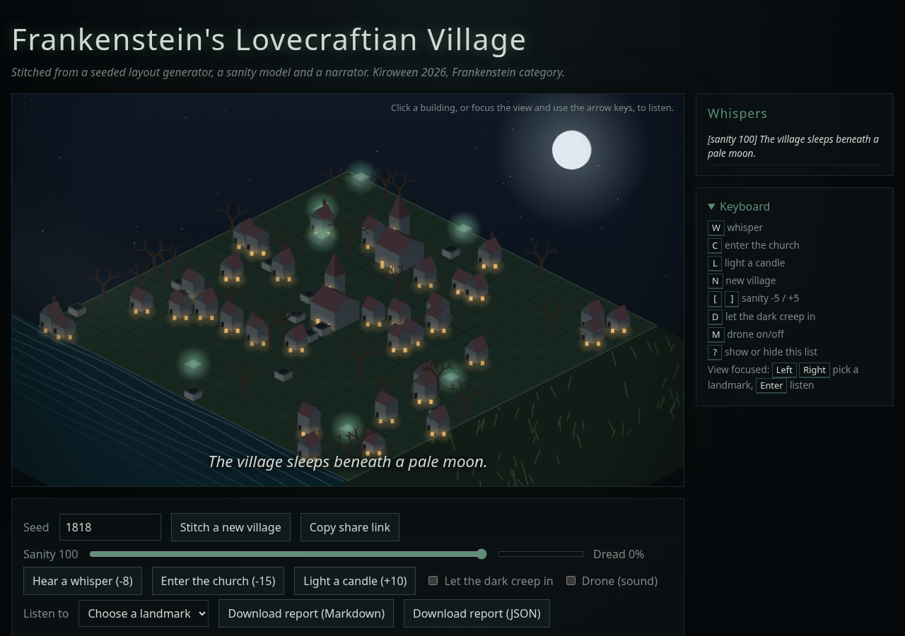
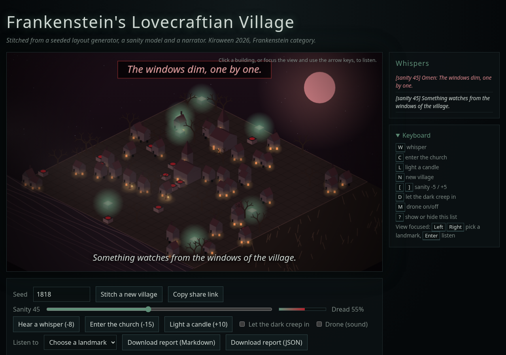
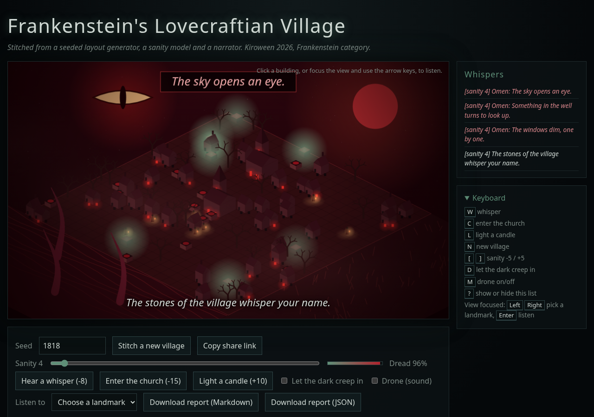
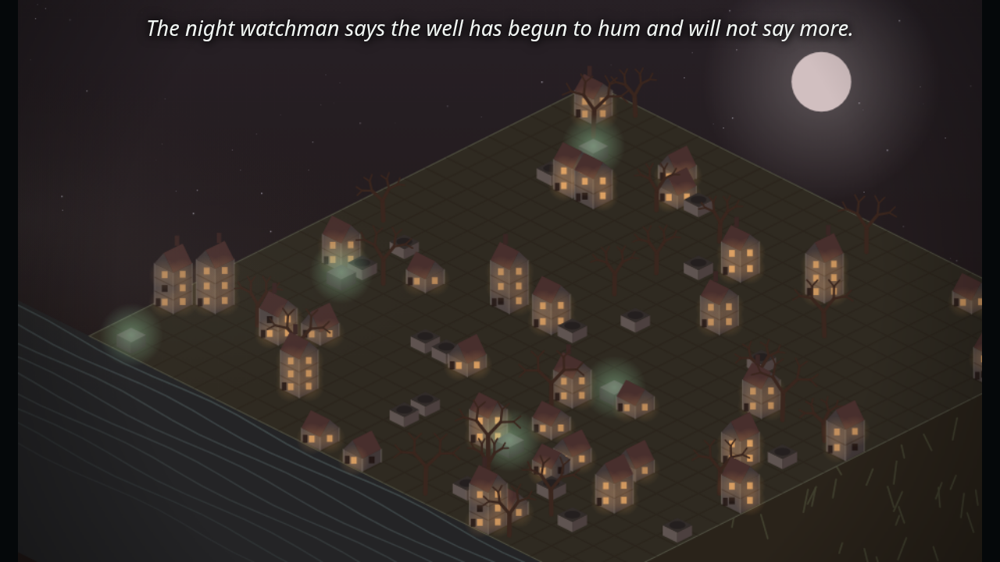
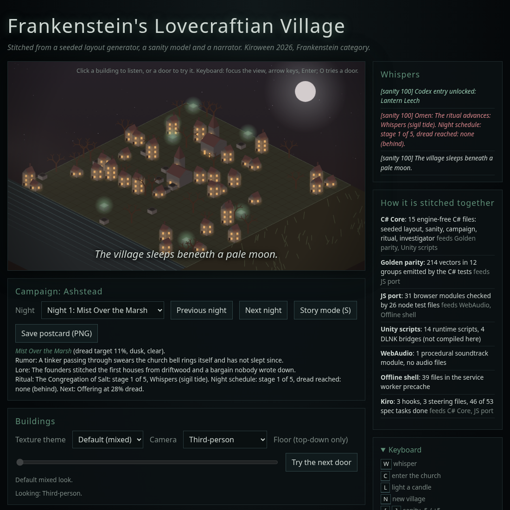
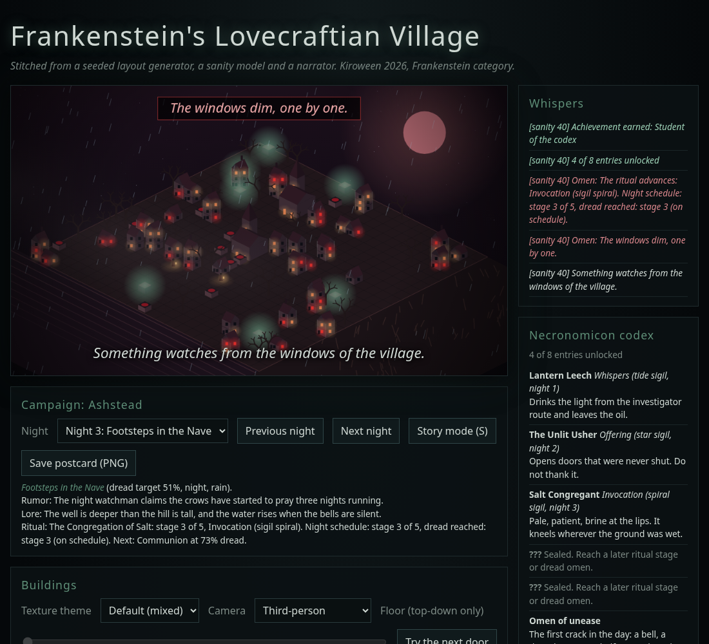
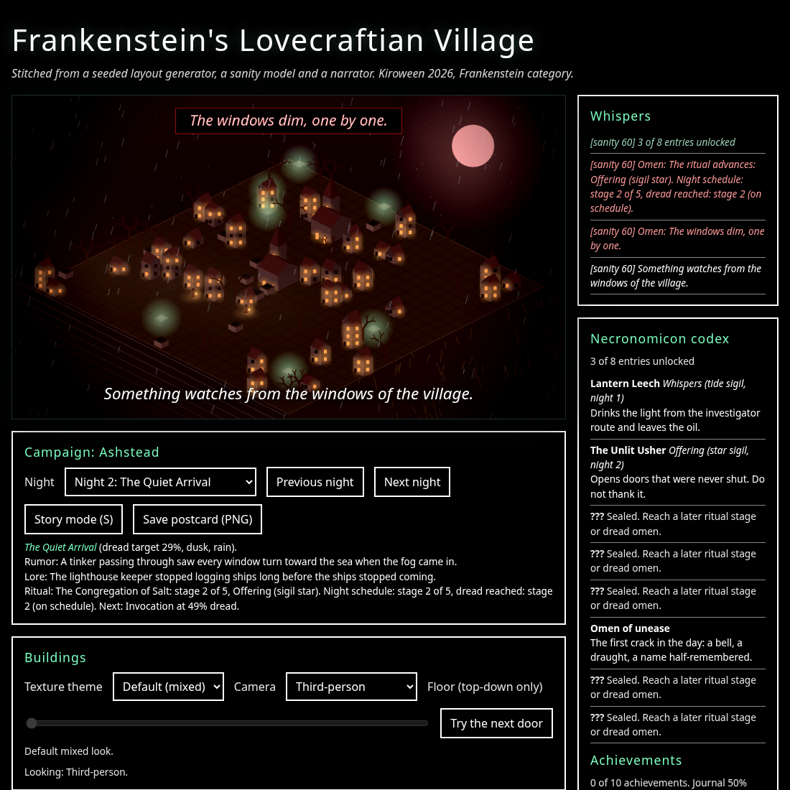
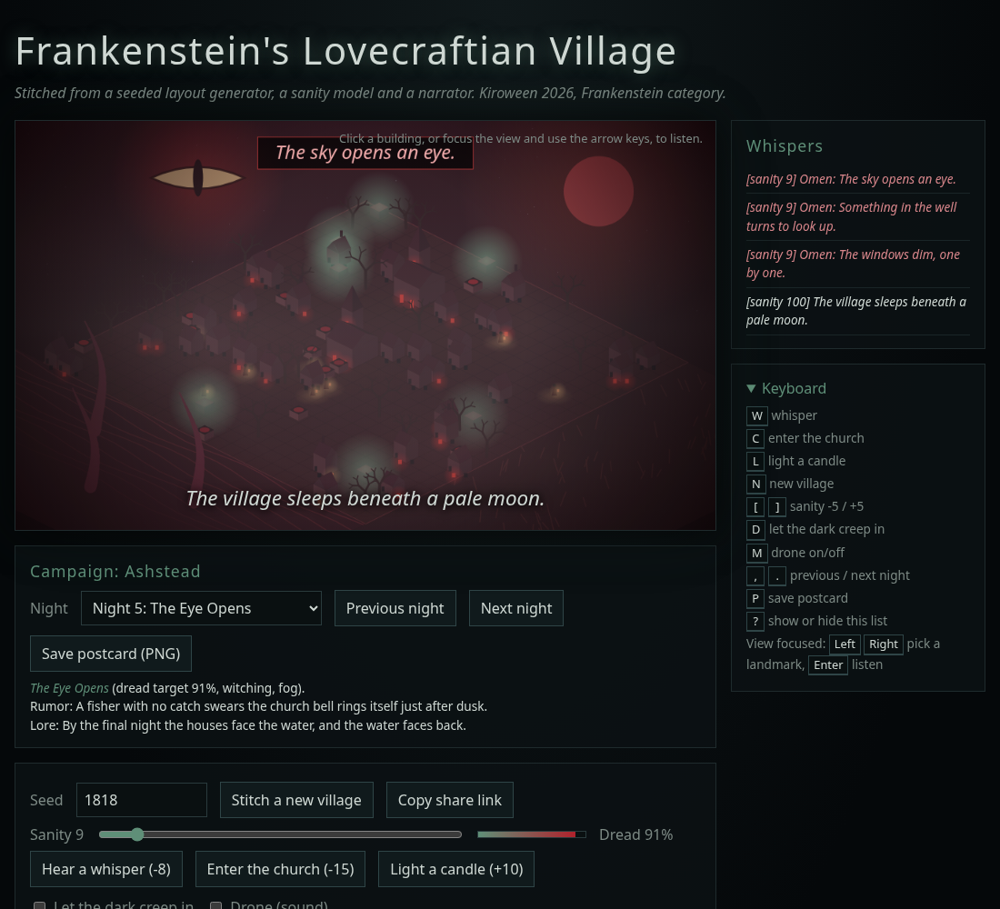

# Frankenstein's Lovecraftian Village

[](https://github.com/MiChaelinzo/Frankenstein-s-Lovecraftian-Village/actions/workflows/ci.yml)



**Play in your browser:** [https://frankensteinlovecraftianvillage.vercel.app/](https://frankensteinlovecraftianvillage.vercel.app/) (deep link: [seed 1818, sanity 100, night 1](https://frankensteinlovecraftianvillage.vercel.app/#seed=1818&sanity=100&night=1)). Deployed on Vercel; HTTP-level checks are recorded below (`python3 tools/check_live.py`). The GitHub Pages workflow is blocked by an account billing lock. See [`docs/HOSTING.md`](docs/HOSTING.md). You can also run it locally (see below).

| Dread | Abyss |
|-------|-------|
|  |  |


A Unity 6 cosmic-horror village environment, built for **Kiroween 2026** in the **Frankenstein** category (#KiroweenHackathon26).

> What happens when cosmic horror, AI development tools, procedural design, and modular game assets are stitched together like Frankenstein's monster?

This project combines Unity 6, AI-assisted development workflows, and a modular Lovecraftian environment to create a dark fantasy village inspired by cosmic horror and environmental storytelling.

## Judge quick start
Open the live site above, or run it locally. You need Python 3 for the server; the demo itself has no dependencies and no build step.

```bash
cd web
python3 -m http.server 8000
# open http://localhost:8000/
```

Useful URLs (append to `http://localhost:8000/`; each feature is opt-in and a bare URL starts none of them):

| URL | What you get |
|-----|--------------|
| `?meshes=1` | Opt-in: draws houses, church, well, altar and trees with the original Blender GLB meshes (`web/assets/meshes`) through the village projector; falls back to the procedural drawing with a console warning if a mesh fails to load |
| `?tour=1` | Guided tour of the features, about a minute, skippable with Esc, keyboard accessible |
| `?codex=1` | Necronomicon codex and achievements panel |
| `?stitch=1` | How the parts are stitched together (generated from the repo) |
| `?cinematic=1` | Cinematic capture mode with a scripted camera |
| `?contrast=1` | High-contrast theme |
| `?daily=1` | Today's village: one seed for everyone on the same date |
| `?pack=1` | Textures from your own local pack, only if you built `web/local-pack/` yourself (see below); otherwise a notice |

Press `A` or use the About button for credits and license. `?lang=fr` switches to French. Which logic lives in Core and which is UI-only: [`docs/ARCHITECTURE_AUDIT.md`](docs/ARCHITECTURE_AUDIT.md). Checks: `python3 tools/validate_repo.py`, `node --test "web/test/*.test.js"` and `dotnet test tests/Frankenstein.Core.Tests`. Nothing here was run inside the Unity editor.

## Play it in your browser (no Unity, no download)
A judge-friendly web demo lives in [`web/`](web). It uses the same Core logic as the Unity project, ported to dependency-free JavaScript and verified against C# output, and draws a procedural isometric village with only canvas shapes (no paid assets).

- Live: [https://frankensteinlovecraftianvillage.vercel.app/](https://frankensteinlovecraftianvillage.vercel.app/) on Vercel. Hosting configs for Netlify, Vercel and Cloudflare Pages plus a safe staging script are in [`docs/HOSTING.md`](docs/HOSTING.md); only Vercel has been deployed. [`pages.yml`](.github/workflows/pages.yml) is blocked by a GitHub billing lock.
- Change the **seed** for a new village, drag **sanity** down to watch the vignette close in, the fog thicken, the moon redden and the narrator turn on you. Click buildings for whispers. Open **Story mode** (`S`) to step or autoplay through every beat of every night. A skippable intro plays on a bare URL. Tick **Music** to opt in to an original procedural WebAudio soundtrack (no audio files, silent until you opt in, with volume and mute).
- Story deep links: `#seed=1818&story=1&night=3&beat=2` (beat is 0-based within the night); `?story=1&autoplay=1` starts playing. `?intro=0` or `#intro=0` skips the intro, and any `#seed=`, `#story=`, `#sanity=` or `#night=` link skips it automatically.
- Share a state with the URL hash, for example `#seed=1818&sanity=35`.
- **Cinematic mode** for clean video takes: `?intro=0&cinematic=1#seed=1818&night=3` (or press `B`). Chrome is hidden and a scripted camera pans through that night's story beats on fixed timings, then the page returns. Reduced motion keeps the camera still. See [docs/DEMO_SCRIPT.md](docs/DEMO_SCRIPT.md).
- **Gamepad and touch**: stick or d-pad pick a landmark, A listen, B door, X whisper, Y candle, Start story, Select cinematic; swipe sideways on the view to pick a landmark, up for a candle, down for a whisper. Mapping is unit tested; not tried on real hardware here.


- **Stitch panel** (`Y`, the Stitch button or `?stitch=1`): how the parts connect (C# Core, golden parity, JS port, Unity scripts, WebAudio, offline shell, Kiro hooks, steering and spec tasks). Every number is read from the repo by `tools/gen_stitch.py` into `web/data/stitch.json`; the validator fails if that file is stale.
- **Necronomicon codex and achievements** (`K`, the Codex button or `?codex=1`): a seeded bestiary, one creature per ritual stage (order shuffled per seed) plus one entry per dread omen, unlocked as the ritual advances and omens rise. Ten achievements (first whisper, three doors, every night, full journal, Abyss, final ritual stage, half and full codex, investigator route) and a journal completion percentage. Both are saved in the session; older saves still load.
- **High contrast** (`H`, the button or `?contrast=1`): white on black panels, thick borders and a yellow focus ring; the choice is remembered on this device.
- **Today's village** (`Z`, the button or `?daily=1`): opt-in only. The seed comes from the UTC date, so everyone who opts in on the same day gets the same village. A bare URL never uses it.

|  |  |
|---|---|


- Optional AI narration: add `?narrator=https://your-endpoint` (POST `{location, dread}`, reply `{text}`); any failure falls back to offline text.

What the demo does:
- **Buildings panel (DLNK-style)**: texture themes Bricks, Plaster, Tiles, Wood, Rocks and Water, grouped under the DLNK groups Construction, Manmade and Nature (our own mapping; `?theme=bricks` or `#theme=bricks`). With `?pack=1` the theme uses the matching local pack texture when the manifest has one (Water has none, so it stays procedural). A camera selector (`cam=first|third|top|auto`) offers a first-person look, third-person and a top-down cutaway with a floor peel slider (`floor=N`); top-down is refused at Abyss dread, as in `DreadBuildingPolicy`. Click a door (or press `O`) to see it creak, slam or refuse, chosen by `doorOmen` and deterministic per seed and attempt. Buildings lose detail (textures, lit windows, doors, roofs) as dread rises, via `detailLevel`. Keys: `T` theme, `V` camera, `F` peel, `O` door. Not Unity footage; this is the web port of the policy.
- **Omen events**: crossing Uneasy, Dire and Abyss thresholds (with hysteresis) raises a toast; tentacles appear at Dire and Abyss and a sky eye opens at Abyss.
- **Campaign mode**: a seeded five-night story arc (village name, night titles, rumors, lore, rising dread targets). Pick a night to set its starting sanity, sky tint (dusk, night, witching hour) and weather (clear, rain, fog). `#night=N` in the URL shares a night. `P` saves a postcard PNG with village name, seed and night. Rain and fog are static under reduced motion.


- **Whispers journal**: every whisper is kept, so you can reread what the narrator said.
- **Village report**: download a Markdown or JSON report of the current seed, sanity and layout.
- **Accessibility**: full keyboard control, skip link to the village view, live regions for toasts and cinematic captions, a screen reader description of the village, reduced motion (`prefers-reduced-motion` or `?reduced=1`; `?capture=1` is the same static rendering for screenshots), responsive layout.

| Key | Action |
|-----|--------|
| `W` | whisper |
| `C` | enter the church |
| `L` | light a candle |
| `N` | new village |
| `[` `]` | sanity -5 / +5 |
| `D` | let the dark creep in |
| `M` | music on/off |
| `U` | mute |
| `S` | story mode (then `,` `.` or Left / Right step, Space play/pause, Esc exit) |
| `B` | cinematic capture mode (`B` or `Esc` leaves) |
| `K` | codex and achievements |
| `Y` | stitch panel |
| `H` | high contrast |
| `Z` | today's village (opt-in daily seed) |
| `?` | show or hide the list |
| Left / Right / Enter | with the canvas focused: pick a landmark and listen |

Run locally (ES modules need HTTP, not `file://`):
```bash
python3 -m http.server -d web 8000   # then open http://localhost:8000
```

### Verification status
Labels: **Verified** = executed by an automated test or command here; **Partially Verified** = checked by inspection, screenshots or a stub-based compile only; **Unverified** = not executed. Nothing that needs the Unity editor is Verified. A validator check (`tools/verification_labels.py`) keeps the Status column of this README table to these three labels (other docs that use the same words are not checked).

| Area | Status | Evidence |
|------|--------|----------|
| Core (`Assets/Scripts/Core`): layout, catalog, sanity, dread, events, report, matcher, DLNK policy, progression rules | Verified | `dotnet test tests/Frankenstein.Core.Tests`: 80 passing property tests |
| JS port (`web/src/core.js` and pure modules) | Verified | `node --test "web/test/*.test.js"`: 247 passing, including golden parity with C# output |
| Repo guardrails (`tools/validate_repo.py`) and Python tools | Verified | `python3 tools/validate_repo.py` and `tools/test_*.py` run locally; `ci.yml` has never been observed running on GitHub |
| Parity self-test page (`web/selftest.html`) | Partially Verified | Checked once in headless Chromium (`docs/media/selftest.png`); not re-run for every change, run it yourself over HTTP |
| Unity Runtime and Editor scripts compile (`tests/UnityCompileCheck`) | Partially Verified | `dotnet build`: 0 errors, 1 warning against hand-written stubs; proves syntax and types only, not Unity behavior or real API fidelity |
| Web demo visuals | Partially Verified | Headless Chromium screenshots (`docs/media`) inspected; not tested across browsers |
| Web soundtrack (`music.js`) | Partially Verified | Pure logic is node-tested; the audio output was never listened to |
| Unity Runtime scripts (`VillageBuilder`, `HorrorAmbienceDirector`, `DreadVolumeBlender`, `HttpNarrationProvider`, `WalkthroughController`, `Dlnk*Bridge`, see [docs/DLNK_INTEGRATION.md](docs/DLNK_INTEGRATION.md)) | Unverified | Never run in the Unity editor |
| Unity Editor tools (`VillageCoreInspectorWindow`, `CatalogAutoBinder`) | Unverified | Never run in the Unity editor |
| HDRP look and URP roles | Unverified | No Unity run |
| Unity and Blender MCP | Unverified | Never run here, see [docs/MCP.md](docs/MCP.md) |
| Hosted web demo | Verified | HTTP 200 on all entry pages and modules plus served CSP, checked by curl (`python3 tools/check_live.py`, 10/10 checks) |
| Hosted demo in a real browser, offline shell on a host | Unverified | Only HTTP responses were checked, see [docs/HOSTING.md](docs/HOSTING.md) |
| Gamepad on real hardware | Unverified | Only logic is node-tested |

Round 12 additions: `tools/dlnk_scene.py` plus `?pack=1&scene=<name>` render real scene placements from the owner's local pack (git-ignored, EXR lightmaps not decoded); `tools/blender/` builds seven original low-poly GLB meshes headless with Blender 4.2 LTS (viewer: `web/meshes.html`, linked from About); `tests/UnityCompileCheck` is a stub-based compile check (0 errors, 1 warning, not a Unity run). MCP for Unity and Blender is documented in [docs/MCP.md](docs/MCP.md) but was never run here, and no `mcp.json` is shipped. No live URL exists yet.

The web demo places 80 pieces. The Unity `VillageBuilder` default `pieceCount` is 40, so set it to 80 to get the same village for the same seed.

## Downloads

The original environment packages are hosted on OneDrive due to GitHub file size limitations.

### Unity 6 HDRP Package

Download:
https://1drv.ms/u/c/2d20f0550256da29/IQB1mE-VisgWS4w-AoMNj6pTAQiJ_psYXKWDPJKcFUDpErQ?e=45G2wE

### Unity 6 URP Package

Download:
https://1drv.ms/u/c/2d20f0550256da29/IQB9YNYXG0m2R7Z-3HOg2HmfARYqxwE4_Vvxa-Hth-dssso?e=opLROG

#### Inspecting the pack locally

Both packages were downloaded through these public share links (anonymous guest flow, no credentials) and inspected locally. Their sizes and checksums:

| Package | Size | sha256 |
|---|---|---|
| URP | 106,390,596 bytes | `939bc792eeccb4779be0c5bb6d12c0ad712f7daa3711021c43a5794757df60b8` |
| HDRP | 1,878,426,676 bytes | `8bc5c2c1be7c639340512e54c49ab118db5f7a9aeaa2d0410a273e863651b488` |

What is inside (from the inspector): both are render-pipeline editions of Lovecraftian Village 1.3 and contain **no meshes** (no `.fbx` or `.obj`). URP has 405 assets (230 materials, 71 `.exr` lightmaps, 12 terrain layers, 3 scenes, 3 shaders, 7 PNGs). HDRP has 605 assets (231 materials, 270 PNGs that are HDRP MaskMap (159) and DetailMap (107) textures with no albedo/BaseColor PNGs, 11 `.exr`, 3 scenes, 5 shaders). Each has only 14 prefabs (lamps, candle holders, GameSetup Basic). Everything imports under `Assets/_DLNK/`. The three scenes (Coast Scene, MystVillage, Assets 1.0) reference 585 unique prefab GUIDs (about 317 unique instance names) for houses, walls, roofs, trees and boats; those prefabs are not in these packages and come from the base pack.

Tools (Python standard library only, nothing is committed):

```
python3 tools/fetch_pack.py urp                 # or hdrp; saves to Assets/ThirdParty/LovecraftianVillage/downloads/
python3 tools/inspect_unitypackage.py Assets/ThirdParty/LovecraftianVillage/downloads/Lovecraftian1.3_HDRP_Unity6.unitypackage --out Assets/ThirdParty/LovecraftianVillage/pack_inventory_hdrp.json
python3 tools/build_local_pack.py               # builds web/local-pack/ from the HDRP package (falls back to URP)
```

- `tools/fetch_pack.py` downloads a package from the share links above, checks HTTP 200, the gzip magic and the size, and prints the sha256. It refuses output paths that are not git-ignored.
- `tools/inspect_unitypackage.py` reads `pathname` entries and scans the `.unity` scenes in memory for `PrefabInstance` blocks, so it reports `referencedPrefabs` (guid, name, count, scenes), a summary and whether meshes exist. It suggests a prefab for each catalog id from packaged names and scene-referenced names with the same scoring as `PrefabNameMatcher`, and checks each catalog `prefabHint`. Payloads are never written to disk.
- Catalog `prefabHint` (names only, no GUIDs) points each id at a real name referenced by the pack scenes. `church`, `well` and `altar` are **stand-ins**, because the pack has no church, well or altar prefab: church uses `Pinnacle00c`, well uses `WoodBucket00`, altar uses `PillarStone00a`. The others are `house_a` BigHouse00, `house_b` CoastalHouse00 and `dead_tree` _Sp_TrunkDead00.
- `tools/build_local_pack.py` extracts about 8 small grayscale textures (DetailMap R or MaskMap G, downscaled to 256 px) plus material tints into `web/local-pack/` with a `manifest.json`. Open the web demo with `?pack=1` (for example `web/index.html?pack=1` served locally) to texture the canvas ground, walls, roofs and dead trees and to label pieces with the real prefab hint names. Without the folder, or without `?pack=1`, the demo is unchanged; with `?pack=1` and no folder it shows a notice and renders normally.

Local, git-ignored paths produced by these tools: `Assets/ThirdParty/LovecraftianVillage/downloads/*.unitypackage`, `Assets/ThirdParty/LovecraftianVillage/pack_inventory_urp.json` and `pack_inventory_hdrp.json`, `web/local-pack/` (`manifest.json`, `textures/`, `screenshots/`), `/pack-scratch/`, and the Unity import location `Assets/_DLNK/`. Pack-mode screenshots are never committed (`docs/media` holds only the demo's own procedural screenshots).

Verification status: the tools and the web pack mode were run here against the real packages and are covered by Python and node tests. Nothing was imported or compiled in Unity, so `CatalogAutoBinder` and the other Editor/Runtime scripts remain unverified there.

The URP package (about 100 MB) is enough for inspection and for URP projects; the HDRP package (about 1.9 GB) is only needed for HDRP builds. The packages are the work of DLNK Artworks (see Credits) and are linked from OneDrive, not stored in this repository. Do not commit them.

## Features

- Unity 6 compatible
- HDRP and URP support
- Lovecraftian horror atmosphere
- Modular village building system
- Fantasy and horror environment design
- First-person, third-person, and top-down compatibility
- AI-assisted development workflow
- **Ritual chain**: a seeded cult ritual runs across the campaign nights (stage names, sigils, rising dread thresholds, linked to each night's omen beat). The night panel shows the current stage, the journal logs advances, and the case file lists the chain. Core code is shared with C# via golden parity; night N sets a floor of ritual stage N and dread can run ahead (the HUD shows "Night schedule: stage X of N, dread reached: stage Y" plus the effective stage). Unity `RitualDirector`, `RitualStateAsset` and `RitualSaveBridge` are Unverified in Unity (not compiled here); the Core logic is Verified.
- **Investigator** (off by default): a seeded investigator walks a lantern route between village pieces and loses sanity at omen sites (altar, well, church, dead tree). Press `I`, use the Investigator button or open with `?investigator=1`. Same seed gives the same route and hits in C# and JS (golden parity). Shows a lantern figure, a minimap marker and journal entries, and the screen reader description lists what stands in the village.
- Web demo extras: session save/load with auto-resume, village map and legend (`G`), case file export (Markdown or HTML), `?lang=fr` partial French, performance readout (`X` or `?perf=1`), offline shell via service worker on https/localhost (never in `?pack=1`)
- Built for Kiroween 2026 Frankenstein challenge

## The Frankenstein pitch
Unlike parts, one creature:

| Part | Role |
|------|------|
| Lovecraftian Village 1.3 (HDRP or URP, third-party, not committed here) | Modular art kit |
| Procedural stitcher (`VillageLayoutGenerator`) | Assembles pieces by id from a catalog |
| Sanity-driven Horror Director | Turns sanity into dread, audio and HDRP volume blends (`DreadVolumeBlender`) |
| Browser demo (`web/`) | JS port of Core plus canvas village, verified against C# |
| Pluggable AI narration (`INarrationProvider`) | Optional AI text with safe offline fallback |
| Kiro | Specs, steering, hooks and agents that built and guard the project |

## Repository layout
See [.kiro/steering/structure.md](.kiro/steering/structure.md). Pure logic is in `Assets/Scripts/Core` (no Unity dependency), Unity glue in `Assets/Scripts/Runtime`.

## Setup
1. Install **Unity 6** (6000.0.x). Use the HDRP template modules for the HDRP package, or URP for the URP package.
2. Clone this repo and open it as a Unity project.
3. Download the package that matches your render pipeline from the Downloads section above (the OneDrive links are the only supported source; the packages are imported locally and never committed).
4. Import it: `Assets > Import Package > Custom Package...`, pick the `.unitypackage`, and import everything. Keep the default `Assets/Lovecraftian Village*` location; those folders are gitignored.
5. Create a `Frankenstein > Village Catalog` asset, then either run the auto-binder (`CatalogAutoBinder` in `Assets/Scripts/Editor`, matches catalog ids to imported prefab names; Unverified in Unity) or add bindings by hand (ids from `Assets/Data/village_catalog.json`) and assign the imported prefabs.
6. Add a `VillageBuilder` and a `HorrorAmbienceDirector` to a scene.
7. Optional: create two global Volumes (calm and dread, same overrides) and assign them to a `DreadVolumeBlender`, then reference it from the director. Set `narrationEndpoint` on the director for HTTP AI narration.

The Unity-side pieces (catalog binding, scene, `DreadVolumeBlender`, `HttpNarrationProvider`) have not been run in the Unity editor yet; the Core logic they wrap is tested.

### Which package do I import?
| Your project | Package | Notes |
|--------------|---------|-------|
| HDRP (this repo's default) | `Lovecraftian1.3 HDRP(Unity6).unitypackage` | `Packages/manifest.json` references `com.unity.render-pipelines.high-definition`, so it works as is. |
| URP | `Lovecraftian1.3 URP(Unity6).unitypackage` | The scaffold manifest targets HDRP. Swap `com.unity.render-pipelines.high-definition` for `com.unity.render-pipelines.universal` in `Packages/manifest.json` (or create a URP project and copy `Assets/Scripts`, `Assets/Data`), then import the URP package. |

Do not import the HDRP package into a URP project or the reverse: materials and shaders will render pink. The scripts in `Assets/Scripts` do not depend on a render pipeline.

### Legal and asset-handling note
The Lovecraftian Village pack is third-party content by DLNK Artworks. It is **not** committed to this repository: `.unitypackage` files and the imported pack folders are gitignored, and `tools/validate_repo.py` fails if pack files are added. Respect the pack's license and obtain it only from the OneDrive links in the Downloads section and import it locally. Git LFS is not used and is not needed. The repo's own code and docs are Apache-2.0.

## Run the tests (no Unity needed)
```bash
dotnet test tests/Frankenstein.Core.Tests
node --test "web/test/*.test.js"      # JS port, including parity with C# output (Node 20+)
python3 tools/validate_repo.py
```
After intentionally changing Core behavior, regenerate the parity contract with `UPDATE_GOLDEN=1 dotnet test tests/Frankenstein.Core.Tests`, then `node tools/embed_golden.mjs` (refreshes the data used by `web/selftest.html`), and update `web/src/core.js` to match.
The tests are property-based: each property runs 300 seeded random cases and reports the failing seed. If your home directory is read-only, run with `HOME=/tmp/home`.

Contributor guide: [CONTRIBUTING.md](CONTRIBUTING.md). History: [CHANGELOG.md](CHANGELOG.md). Screenshots are produced with `tools/screenshot.sh` (for `?pack=1` it adds `capture=1`, a static still frame, because the animated loop never finishes under headless virtual time).

## Built with Kiro
Specs, hooks and steering are in [`.kiro/`](.kiro). Details in [docs/KIRO_USAGE.md](docs/KIRO_USAGE.md). Build history: [docs/BUILD_LOG.md](docs/BUILD_LOG.md). Demo script: [docs/DEMO_SCRIPT.md](docs/DEMO_SCRIPT.md). Submission draft: [docs/DEVPOST_SUBMISSION.md](docs/DEVPOST_SUBMISSION.md). Blog draft: [docs/BLOG_POST.md](docs/BLOG_POST.md).

## License
Apache License 2.0, see [LICENSE](LICENSE) and [NOTICE](NOTICE).

## Challenge Theme

**Frankenstein**

Stitch together a chimera of technologies into one project.

This submission combines:

- Unity 6
- Kiro AI-assisted development
- Lovecraftian horror themes
- Modular environment art
- Procedural design concepts
- Narrative worldbuilding

## Credits

Environment assets courtesy of DLNK Artworks' Lovecraftian Village environment pack.

Created by Michael G. Inso for Kiroween 2026.
